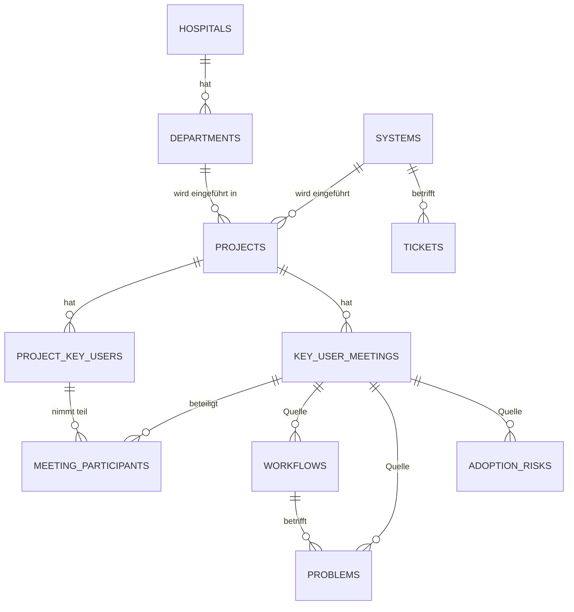
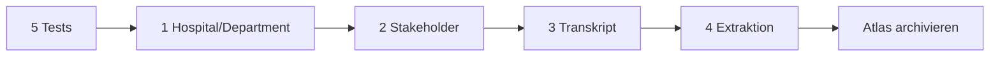

# Integrationsplan: Project Atlas → Ticketsystem

Portiert den validierten Kern von [Project Atlas](https://github.com/knopkec/Project-Atlas)
(FastAPI/Python-Prototyp) in dieses Node/Express/SQLite-System. Danach wird
Project Atlas archiviert.

Entscheidungsgrundlagen: [GLOSSARY.md](../GLOSSARY.md),
[ADR-0001](./adr/0001-projekt-ist-die-einheit.md),
[ADR-0002](./adr/0002-problem-ist-kein-ticket.md),
[ADR-0003](./adr/0003-termin-ist-der-anker.md).

## Zielmodell



Ein **Termin** ist das Ereignis (bisher `key_user_meetings`), optional mit
Transkript. Aus ihm werden **Workflow**, **Problem** und **Adoptionsrisiko**
extrahiert. **Tickets** bleiben davon getrennt (ADR-0002).

## Ausgangslage (geprüft)

| Fakt | Fundstelle |
|---|---|
| Schema + Migrationen inline, ~30 Blöcke | `ticketsystem/server.js` (ab Zeile ~500) |
| `projects` inkl. `status`-CHECK + Rebuild-Migration | `server.js:1234`, `1244-1275` |
| Key-User-API (Anlegen/Aktualisieren in einem Handler) | `server.js:4127` |
| Termin-API (CRUD, ICS, Status) | `server.js:4337-4470` |
| Projekt-API (`GET/POST/PATCH`) | `server.js:3585-3642` |
| Projektformular | `templates/projects.ejs:68-118` |
| Tests: HTTP-JSON-Smoke, harte Seed-Assertions | `tests/test.js` |
| `PORT` / `DB_FILE` env-konfigurierbar | `server.js:62`, `64` |
| Seed-Skript ignoriert `DB_FILE` (hart `tickets.db`) | `scripts/seed_db.js:4` |

## Schritt 1 — Krankenhaus und Abteilung

**Schema**
```sql
CREATE TABLE hospitals (
    id INTEGER PRIMARY KEY AUTOINCREMENT,
    name TEXT NOT NULL,
    created_at DATETIME DEFAULT CURRENT_TIMESTAMP
);

CREATE TABLE departments (
    id INTEGER PRIMARY KEY AUTOINCREMENT,
    hospital_id INTEGER NOT NULL,
    name TEXT NOT NULL,
    active INTEGER DEFAULT 1,
    created_at DATETIME DEFAULT CURRENT_TIMESTAMP,
    UNIQUE(hospital_id, name),
    FOREIGN KEY (hospital_id) REFERENCES hospitals(id) ON DELETE CASCADE
);

-- projects: Spalte ergänzen, dann Pflicht machen
ALTER TABLE projects ADD COLUMN department_id INTEGER REFERENCES departments(id);
```

**Backfill** (idempotent, beim Start):
1. `hospitals` leer → `Klinikum Südstadt` anlegen.
2. `departments` leer → `Allgemein` am Default-Krankenhaus anlegen.
3. `UPDATE projects SET department_id = <Allgemein> WHERE department_id IS NULL`.

**Pflichtfeld:** SQLite kann `NOT NULL` nicht per `ALTER` ergänzen. Rebuild der
`projects`-Tabelle nach dem bereits vorhandenen Muster (`server.js:1244-1275`):
`PRAGMA foreign_keys=OFF` → `projects__new` mit `department_id INTEGER NOT NULL`
→ `INSERT ... SELECT` → `DROP` → `RENAME` → `COMMIT` → `foreign_keys=ON`.
Reihenfolge beachten: erst nach erfolgreichem Backfill.

**API**
- `GET /api/hospitals` → Liste (aktuell genau ein Eintrag)
- `GET /api/departments?hospital_id=` → Liste
- `POST /api/departments` `{ name }` → legt am Default-Krankenhaus an, `409` bei
  Duplikat (`UNIQUE(hospital_id, name)`), `400` bei leerem Namen
- `GET /api/projects` und `GET /api/projects/:id` um `department_name` und
  `hospital_name` erweitern (`LEFT JOIN`)
- `POST /api/projects` und `PATCH /api/projects/:id`: `department_id` in
  `allowed` aufnehmen, `400` wenn fehlt/unbekannt

**UI** (`templates/projects.ejs`, Entscheidung Q4b — nur im Projektformular)
- Feld **Abteilung** als `<select>` mit den vorhandenen Abteilungen
- Option `+ Neue Abteilung…` blendet ein Textfeld ein; Absenden legt die
  Abteilung per `POST /api/departments` an und wählt sie aus
- Pflichtfeld, kein „Keine Abteilung"-Eintrag
- Anzeige der Abteilung in der Projektliste und im Projekt-Dashboard

**Tests**
- Abteilung anlegen → `201`, Duplikat → `409`, leerer Name → `400`
- Projekt ohne `department_id` → `400`
- Projekt mit gültiger Abteilung → `201`, `GET` liefert `department_name`
- Bestandsprojekte tragen nach dem Start `Allgemein`

## Schritt 2 — Key-User als Stakeholder

**Schema**
```sql
CREATE TABLE meeting_participants (
    id INTEGER PRIMARY KEY AUTOINCREMENT,
    meeting_id INTEGER NOT NULL,
    key_user_id INTEGER NOT NULL,
    UNIQUE(meeting_id, key_user_id),
    FOREIGN KEY (meeting_id) REFERENCES key_user_meetings(id) ON DELETE CASCADE,
    FOREIGN KEY (key_user_id) REFERENCES project_key_users(id) ON DELETE CASCADE
);
```
Bewusst ohne `department_id` an `project_key_users` — siehe „Offener Punkt" unten.

**API**
- `POST /api/meetings/:meetingId/participants` `{ key_user_ids: [] }` → ersetzt
  die Teilnehmerliste des Termins, `404` bei fremdem Key-User (muss zum selben
  Projekt gehören)
- `GET /api/projects/:projectId/meetings` liefert `participants` je Termin mit

**UI** (`templates/project-meetings.ejs`, `templates/project-keyusers.ejs`)
- Im Termin-Formular Mehrfachauswahl der Key-User des Projekts
- Key-User-Liste zeigt je Person die Anzahl Termine

**Tests**
- Teilnehmer setzen → `200`, `GET` enthält sie
- Key-User aus fremdem Projekt → `404`
- Termin löschen entfernt Teilnehmer (CASCADE)

## Schritt 3 — Transkript

**Schema**
```sql
ALTER TABLE key_user_meetings ADD COLUMN transcript TEXT;
```

**API**
- `GET /api/meetings/:id/transcript` → `{ transcript }`
- `PUT /api/meetings/:id/transcript` `{ transcript }` → speichert (Admin)
- `GET /api/projects/:projectId/meetings` liefert `has_transcript` (boolean),
  **nicht** das Transkript selbst (Listen bleiben klein)

**UI**
- Termin-Detail: Textarea + Ansicht, Collapsible, Zeichenzähler

**Tests**
- PUT/GET Roundtrip inkl. Umlauten
- `has_transcript` in der Liste korrekt
- leeres Transkript → `200`, `has_transcript = false`

## Schritt 4 — Workflow, Problem, Adoptionsrisiko

**Schema**
```sql
CREATE TABLE workflows (
    id INTEGER PRIMARY KEY AUTOINCREMENT,
    meeting_id INTEGER NOT NULL,
    department_id INTEGER NOT NULL,
    description TEXT NOT NULL,
    created_at DATETIME DEFAULT CURRENT_TIMESTAMP,
    FOREIGN KEY (meeting_id) REFERENCES key_user_meetings(id) ON DELETE CASCADE,
    FOREIGN KEY (department_id) REFERENCES departments(id) ON DELETE CASCADE
);

CREATE TABLE problems (
    id INTEGER PRIMARY KEY AUTOINCREMENT,
    meeting_id INTEGER NOT NULL,
    department_id INTEGER NOT NULL,
    workflow_id INTEGER,
    title TEXT NOT NULL,
    description TEXT DEFAULT '',
    created_at DATETIME DEFAULT CURRENT_TIMESTAMP,
    FOREIGN KEY (meeting_id) REFERENCES key_user_meetings(id) ON DELETE CASCADE,
    FOREIGN KEY (department_id) REFERENCES departments(id) ON DELETE CASCADE,
    FOREIGN KEY (workflow_id) REFERENCES workflows(id) ON DELETE SET NULL
);

CREATE TABLE adoption_risks (
    id INTEGER PRIMARY KEY AUTOINCREMENT,
    meeting_id INTEGER NOT NULL,
    department_id INTEGER NOT NULL,
    title TEXT NOT NULL,
    description TEXT DEFAULT '',
    created_at DATETIME DEFAULT CURRENT_TIMESTAMP,
    FOREIGN KEY (meeting_id) REFERENCES key_user_meetings(id) ON DELETE CASCADE,
    FOREIGN KEY (department_id) REFERENCES departments(id) ON DELETE CASCADE
);
```

`department_id` wird beim Anlegen aus `Termin → Projekt → Abteilung` gesetzt,
nie vom Client übernommen (Atlas validiert hier gegen Cross-Department-Referenzen;
wir verhindern die Möglichkeit stattdessen).

**API**
- `POST /api/meetings/:meetingId/workflows|problems|adoption-risks` → `201`
- `GET /api/projects/:projectId/workflows|problems|adoption-risks` → Aggregat
  über alle Termine des Projekts
- `DELETE /api/problems/:id` etc. (Admin) — Erfassung muss korrigierbar sein
- `PATCH /api/problems/:id` für `workflow_id` (Zuordnung nachziehen)

**UI** (`templates/project-meetings.ejs`)
- Am Termin vier Abschnitte: Workflow, Probleme, Adoptionsrisiken, Teilnehmer
- Problem-Formular mit optionaler Workflow-Auswahl
- Sammelansicht im Projekt-Dashboard: offene Probleme je Abteilung

**Tests**
- Anlegen je Entität → `201`
- `department_id` wird aus dem Projekt abgeleitet, nicht aus dem Body
- Problem mit fremdem `workflow_id` → `400`
- Projekt-Aggregat enthält Einträge aller Termine
- Löschen des Termins entfernt die Extraktion (CASCADE)

## Schritt 5 — Testfundament (parallel zu 1)

- `scripts/seed_db.js:4`: `process.env.DB_FILE` respektieren
- `tests/test.js`: gegen temporäre DB laufen (`DB_FILE=test.db PORT=8011`),
  Seed vorher ausführen, Aufräumen im `finally`
- Harte Seed-Assertions („6 Meilensteine", „Projekt 1 = CuraFlow") durch
  strukturelle ersetzen: Status-Code, Typ, Pflichtfelder, Counts relativ zur
  vorherigen Messung

## Umsetzungsstand

| Schritt | Stand |
|---|---|
| 5 — Testfundament | umgesetzt: `DB_FILE` in `seed_db.js`, Tests starten eigenen Server auf freiem Port mit `tests/test.db`, Seed deterministisch |
| 1 — Krankenhaus/Abteilung | umgesetzt: `hospitals`, `departments`, `projects.department_id`, Backfill, API, Formular mit Inline-Anlage |
| 2 — Stakeholder | umgesetzt: `meeting_participants`, API, Anzeige je Termin |
| 3 — Transkript | umgesetzt: `key_user_meetings.transcript`, API, Viewer/Editor am Termin |
| 4 — Extraktion | umgesetzt: `workflows`, `problems`, `adoption_risks`, API, Erfassung am Termin **und** direkt im Projekt |
| 5 — Flow Analysis | umgesetzt: Reiter `/project/:id/flow` mit Input (Transkripte, Dokumente, Erkenntnisse); Visualisierung und Output als Platzhalter |
| Atlas archivieren | offen (nach Abnahme) |

**Abweichung:** `projects.department_id` ist auf DB-Ebene nullable und wird in der
Anwendung erzwungen (`POST/PATCH /api/projects` → `400`). Grund: `NOT NULL` waere
nur per Tabellen-Rebuild von `projects` moeglich, und dieser Rebuild konkurriert
mit der bestehenden `projects.status`-Migration um dieselbe Tabelle.

**Abweichung von Atlas:** `meeting_id` ist in den Wissenstabellen optional. Ein
Eintrag gehoert immer zu einem Projekt, kann aber ohne Termin erfasst werden.
Siehe [ADR-0004](./adr/0004-wissen-ohne-termin.md). Die Tabellen tragen deshalb
zusaetzlich `project_id`; `department_id` wird daraus abgeleitet.

**Abweichung von Atlas:** Ein Projekt beschreibt beliebig viele **benannte**
Workflows (z. B. „Entlassungsbrief“, „Wochenplan erstellen“), nicht genau einen.
`workflows.name` ist die Ueberschrift der einklappbaren Karte; fehlt er, wird die
erste Zeile der Beschreibung uebernommen. Bestehende Zeilen bekommen den Namen
per Migration nachgezogen.

## Flow Analysis

`/project/:id/flow` ist der Ort der Bestandsaufnahme. Drei Abschnitte:

| Abschnitt | Inhalt | Stand |
|---|---|---|
| Input | Workflows/Probleme/Risiken (mit Herkunft), hochgeladene Dokumente, direkte Erfassung | umgesetzt |
| Input-Visualisierung | BPMN-Diagramm des Ist-Zustands aus der KI-Zusammenfassung (Hoch-/Querformat), bearbeitbar und druckbar | umgesetzt |
| Output | LLM schlaegt den Ziel-Workflow vor; Screenshots und Beschreibungen der fertigen Integration | Platzhalter |

Dateien im Flow-Reiter sind `project_attachments` mit `phase = 'input'`
(Spalte vorbereitet fuer `'output'`). Wissenseintraege koennen aus einem Termin
(`POST /api/meetings/:id/<kind>`) oder direkt im Projekt
(`POST /api/projects/:id/<kind>`) entstehen.

## KI-Zusammenfassung

`POST /api/projects/:id/flow-summary` fasst die Bestandsaufnahme zusammen:

| Aspekt | Umsetzung |
|---|---|
| Eingabe | Projektkopf, Transkripte, Textdokumente, Workflows/Probleme/Risiken (mit Herkunft) |
| Grenzen | 120k Zeichen gesamt, 30k pro Transkript, 20k pro Datei (per ENV anpassbar) |
| Redaction | `services/ai/redact.js` vor dem Aufruf; Treffer werden zurueckgemeldet |
| Modell | KI-Mitarbeiter (`staff.kind='ai'`), Default = einer mit Rolle `planning` |
| Ausgabe | reiner Text mit 5 Abschnitten (Ausgangslage, Ablauf, Probleme, Risiken, offene Punkte) |
| Speicherung | `project_flow_summaries`, versioniert; Anzeige = neueste Version |
| Kosten | Token-Verbrauch landet wie bei den Ticket-Stages in `ai_token_usage` |
| `dry_run: true` | liefert die redigierte Eingabe + Statistik, ohne Modellaufruf |

Nicht maschinell lesbare Dateien (PDF, Word, Excel) gehen **nur mit Dateinamen**
in die Eingabe ein; das steht dann auch so im Prompt, damit das Modell die
Luecke nicht mit Erfundenem fuellt.

**Teststand:** `npm test` — 18 Migrationspruefungen, 17 Eingabe-Checks und 165
Assertions, gruen, wiederholbar.

## Reihenfolge



Schritt 5 zuerst, damit 1–4 überhaupt prüfbar sind. Jeder Schritt ist einzeln
auslieferbar; 4 benötigt 1–3.

## Nicht im Scope

`Recommendation`, `Configuration`, `Lesson Learned`, `Local AI Server`,
`Existing Software`, semantische Suche/pgvector, LLM-Extraktion, Auth (gibt es
hier bereits über Sessions). Diese bleiben im Atlas-Glossary dokumentiert und
werden bei Bedarf als eigener Slice bewertet.

## Risiken

1. **Rebuild von `projects`** mit abhängigen Tabellen (`project_milestones`,
   `project_key_users`, `key_user_meetings`, …). Der vorhandene `status`-Rebuild
   ist der Präzedenzfall; `PRAGMA foreign_keys=OFF` und eine Transaktion sind
   Pflicht. Vor dem Umbau Sicherung von `tickets.db`.
2. **`server.js` wächst weiter.** Der Slice fügt ~10 Routen hinzu. Das ist
   bewusst in Kauf genommen (Entscheidung Q3/b: neuer Code in einem eigenen
   Modul, in `server.js` nur verdrahtet), aber die Verdrahtung muss klein bleiben.
3. **Termin-Umbenennung.** `key_user_meetings` behält den Tabellennamen, die UI
   sagt bereits „Termine". Kein Rename nötig — aber neue Texte dürfen „Meeting"
   nicht wieder einführen.

## Entschieden: keine `department_id` an Key-Usern

Q5 wollte `project_key_users.department_id` ergänzen. Mit ADR-0001 ist diese
Spalte **redundant**: ein Projekt hat genau eine Abteilung, ein Key-User gehört
zu genau einem Projekt — die Abteilung ist immer dieselbe. Die Spalte wird daher
**nicht** angelegt; die Abteilung wird über das Projekt abgeleitet.

Ein Bedarf für „Key-User ohne Projekt einer Abteilung zuordnen" wäre ein anderes
Modell (Abteilung als eigene Ebene) und wurde in ADR-0001 verworfen.
